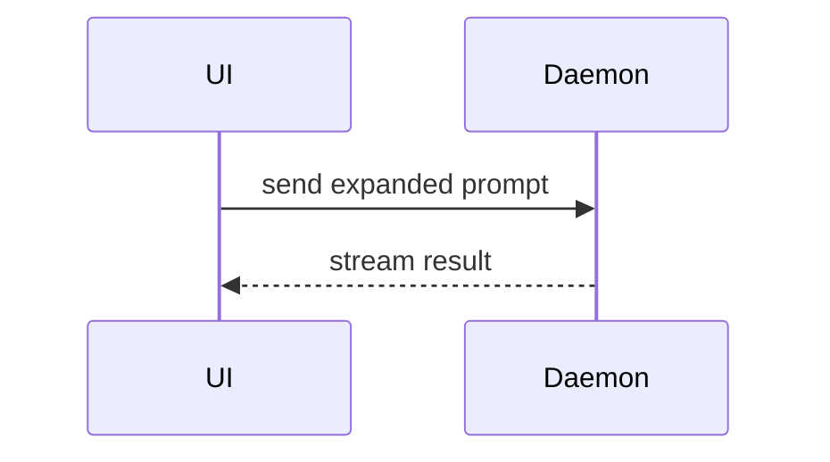

# Summary visuals

Read when choosing how to show a change in the PR Summary. Use one or two of these. Keep only the calls, files, props, states, and boundaries a reviewer needs.

Pseudocode for logic:

```text
on(save)
  if content is unchanged
    return cached result
  write new content
  return fresh result
```

Call tree for runtime flow:

```text
submitForm
  createSession
    persistPrompt
    launchAgent
  navigateToSession
```

Component tree for UI structure, noting state and module boundaries that matter:

```text
<SessionPage> (routes/session.tsx)
  useSessionEvents()
  <SessionToolbar>
    <RunSkillButton> (packages/ui)
```

Shallow file tree for a broad refactor:

```text
src/
├── commands/    # parses user actions
├── sessions/    # owns session state
└── transport/   # sends API requests
```

Mermaid for interaction or data flow:



Diff of a tree or flow when the shape already exists and only part changes. Match the diff to the topic: a call tree, a component tree, a file layout, or control flow.

```diff
 submitForm
   createSession
     persistPrompt
+    expandSkillMention
     launchAgent
-  navigateToSession
+  navigateToSession
+    subscribeToEvents
```

A file-layout change:

```diff
 src/
 ├── commands/
+│   └── show-me.ts   # expands the slash command
 ├── sessions/
-└── transport.ts
+└── transport/
+    ├── client.ts
+    └── stream.ts
```

A control-flow change:

```diff
 on(save)
-  write content
+  if content is unchanged
+    return cached result
+  write new content
+  invalidate cache
```

Show a whole block when most of it is new, when omitted context would hide ownership or order, or when the reader needs a copyable target shape.
