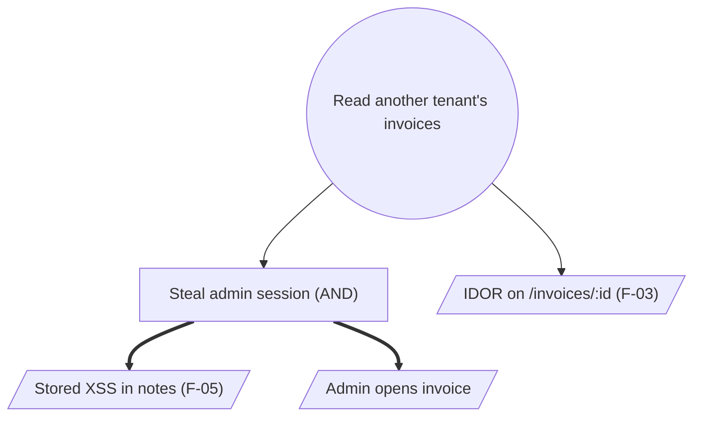

# Attack trees

Read when drawing the attack trees in step 6, or when the user asks for an attack tree on its own. Adapted from the `attack-tree-construction` skill in wshobson/agents (MIT License, see the plugin's LICENSE), condensed and rewritten.

## Pick the goals

Build a tree only for the one or two outcomes an attacker most wants and the team most fears, taken from the findings: take over an account, read another tenant's data, run code on a server, move money, ship a malicious release. A tree per finding is noise. State the goal as an outcome, not a technique ("read another tenant's invoices", not "SQL injection").

## Structure

- **Root:** the goal.
- **OR node:** any one child achieves the parent.
- **AND node:** every child is required. Mark AND explicitly; unmarked children are OR.
- **Leaf:** one concrete attacker step, tied to evidence where possible (a finding id, `path:line`, or a config).

Expand a node until each leaf is a step someone could test or a control could block. Include insider and supply-chain paths (a malicious dependency, a compromised CI token, a support-desk account reset) as well as external ones.

## Leaf attributes

| Attribute | Values | Meaning |
| --- | --- | --- |
| Cost | low, med, high | Money, infrastructure, or access the attacker must buy or build |
| Skill | low, med, high | Expertise needed |
| Time | hours, days, weeks | Effort to execute |
| Detection | low, med, high | Chance the current logging and alerting notices it |
| Prerequisite | none, account, insider, network position, physical | Matches the exploitability tiers in SKILL.md |

Roll attributes up the tree: an OR node takes its cheapest, easiest child; an AND node is as expensive as the sum of its children and as detectable as its most detectable child. The root's cheapest path is the one to defend first.

## Analysis

1. **Cheapest path.** Follow the minimum-cost, minimum-skill branch from the root. Report it with its leaves.
2. **Choke points.** A leaf or sub-goal that appears on many paths (often authentication, session handling, or a shared secret) gives the most coverage for one control.
3. **AND leverage.** Blocking any one child of an AND node blocks that whole branch; pick the cheapest child to defend.
4. **Coverage.** Mark each leaf mitigated (control confirmed in code or config) or open. A path is blocked when at least one of its required leaves is mitigated. List the open paths, cheapest first.
5. **Low detection.** Call out cheap leaves with low detection; they need a detective control even if a preventive one exists.

## Text layout

```
Read another tenant's invoices                       [goal]
├─ OR  Abuse an invoice endpoint without an owner check (F-03)   cost: low  skill: low  detect: low
├─ OR  Steal a tenant admin's session
│   ├─ AND  Stored XSS in the invoice notes field (F-05)         cost: low  skill: med  detect: low
│   └─ AND  Admin opens the shared invoice                       cost: low  skill: low  detect: low
└─ OR  Read the database directly
    ├─ AND  Reach the database port (needs network position)    cost: high skill: high detect: med
    └─ AND  Obtain database credentials from CI logs (F-09)      cost: med  skill: med  detect: low
```

## Mermaid layout

Use when the report renders Mermaid. Circles for OR, rectangles for AND, parallelograms for leaves, thick arrows into AND children.



Shade or annotate open, cheap leaves so the reader sees the priority without the table.

## Pitfalls

- A tree that stops at a vague leaf ("hack the server") hides where a control goes.
- Ignoring AND nodes overstates risk; ignoring cheap OR siblings understates it.
- Trees describe the system as built. When a finding is fixed, mark the leaf mitigated rather than deleting it, so a rerun against a baseline can show the change.
